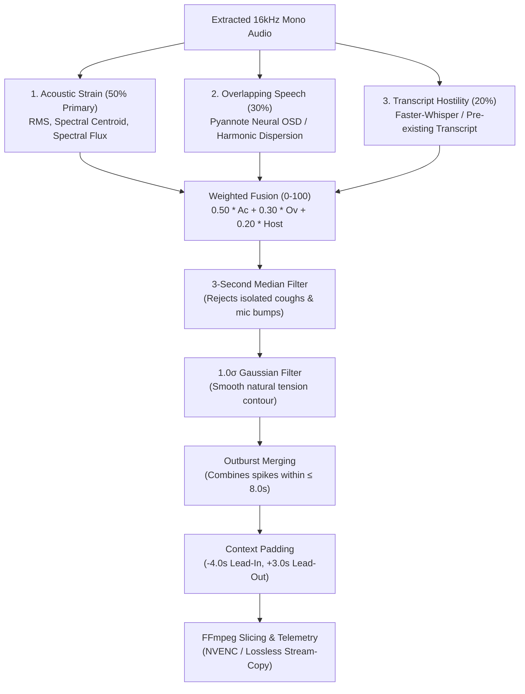

# Tension Engine (`tension_engine/`)

The **Tension Engine** is a modular, multi-signal Python pipeline designed to analyze long political and parliamentary debate footage, detect heated confrontations (arguments, shouting, interruptions, gavel strikes), and export ranked clips with structured telemetry.

---

## 🏛️ Multi-Signal Scoring Architecture

To prevent false positives caused by isolated microphone bumps, polite laughter, or applause, the engine evaluates the video over **1-second rolling analysis windows** across three orthogonal signals:



---

### 1. Acoustic Intensity & Vocal Strain (50% Primary Weight)
- **Module**: [`acoustic_analyzer.py`](acoustic_analyzer.py)
- **Features Extracted via Librosa**:
  - **RMS Energy**: Measures physical volume spikes and shouting power.
  - **Spectral Centroid**: Measures high-frequency energy concentration; when human voices become strained, aggressive, or angry, the vocal cords tighten and shift energy into upper formants ($>2.5\text{ kHz}$).
  - **Spectral Flux**: Measures rapid spectral transition deltas (identifies sudden transient impacts like gavel banging, table slapping, or abrupt outbursts).
- **Normalization**: Computed across the full recording using dynamic Z-scores:
  $$Z = \frac{x - \mu}{\sigma}$$
  and calibrated to a 0–100 scale using a sigmoid curve.

---

### 2. Overlapping Speech & Interruptions (30% Weight)
- **Module**: [`overlap_detector.py`](overlap_detector.py)
- In parliamentary protocol, civil debate consists of one speaker at a time; high tension is marked by cross-talk, cross-shouting, and rapid interruptions.
- **Dual-Engine Design**:
  - **Pyannote Neural OSD**: When a HuggingFace token is available (`--hf-token` or `$HF_TOKEN`), utilizes `pyannote/overlapped-speech-detection`.
  - **Standalone Acoustic Fallback (Offline / Zero-Token)**:
    - *Harmonic Dispersion*: Detects multiple conflicting fundamental frequencies ($F_0$).
    - *Spectral Valley Filling*: Evaluates spectral flatness; multiple voices speaking simultaneously fill in the spectral valleys between harmonic peaks.
    - *Continuous Vocal Duty Cycle*: High speech occupancy with zero inter-syllable pauses signals intense debate cross-talk.

---

### 3. Transcript Sentiment, Speech Rate & Hostility (20% Weight)
- **Module**: [`transcript_analyzer.py`](transcript_analyzer.py)
- **Inputs**:
  - **Pre-computed Transcripts**: Ingests existing JSON files (`words` and `segments` from YouTube API or earlier Whisper runs) in milliseconds.
  - **Faster-Whisper Fallback**: GPU-accelerated (`float16` on CUDA with CPU `int8` fallback) transcription with word-level acoustic timestamps.
- **Signals Evaluated**:
  - **Words-Per-Second (WPS) Acceleration**: Spikes exceeding $>4.5\text{ WPS}$ indicate agitated, rushed speech.
  - **Multilingual Parliamentary Hostility Lexicon**: Scans for parliamentary objections, points of order, and hostile expressions in Arabic, English, and French:
    - *Arabic*: نقطة نظام, اعتراض, كذب, كذاب, اسكت, اخرس, احترم, عيب, فضيحة, مهزلة, بلطجة, etc.
    - *English*: point of order, out of order, shut up, sit down, lie, shame, disgrace, resign, nonsense, etc.
    - *French*: rappel au règlement, mensonge, menteur, honte, taire, silence, scandale, etc.
  - **Exclamation Density**: Frequency of emphatic punctuation (`!`, `؟`, `?!`).

---

## ✂️ Scene Merging, Padding & Video Slicing

### Post-Processing
- **Anti-Spurious Smoothing**:
  1. 3-second moving median filter removes non-speech transient bursts (e.g. mic rustle, short coughs).
  2. Gaussian filter ($\sigma = 1.0$) ensures clean, natural envelope contours.
- **Outburst Spike Merging**: Merges distinct outbursts that occur within $\le 8.0\text{ seconds}$ of each other into a single continuous scene.
- **Context Padding**: Adds **4.0 seconds lead-in** padding before the outburst begins (so viewers hear what triggered the confrontation) and **3.0 seconds lead-out** padding after tension subsides.

### Video Cutting & Telemetry
- **Module**: [`video_cutter.py`](video_cutter.py)
- **Fast FFmpeg Slicing**:
  - Places `-ss` *before* `-i` for instantaneous demuxer seeking.
  - **Hardware Mode**: NVIDIA NVENC (`h264_nvenc`) with CPU (`libx264`) fallback.
  - **Lossless Mode**: `-c copy` stream copy for instantaneous lossless extraction.
- **Naming Convention**: Slices ranked from highest to lowest tension:
  `scene_01_score94.mp4`, `scene_02_score88.mp4`, etc.
- **Structured Report**: Generates `timestamps.json` containing exact start/end timestamps, component signals, and matching transcript snippets.
- **Visual Graph**: Generates a 4-panel `tension_timeline.png` plot showing acoustic, overlap, hostility, and fused tension curves.

---

## 📁 Module Inventory

| File | Class / Helper | Primary Role |
| :--- | :--- | :--- |
| [`__init__.py`](__init__.py) | Package Entrypoint | Exports all analyzers, processors, and cutters. |
| [`audio_extractor.py`](audio_extractor.py) | `extract_audio_from_video` | Extracts 16kHz mono WAV and calculates duration via `ffprobe`. |
| [`acoustic_analyzer.py`](acoustic_analyzer.py) | `AcousticAnalyzer` | Extracts RMS, Centroid, and Flux features; normalizes with Z-scores. |
| [`overlap_detector.py`](overlap_detector.py) | `OverlapDetector` | Dual-engine overlap detection (Pyannote model or acoustic fallback). |
| [`transcript_analyzer.py`](transcript_analyzer.py) | `TranscriptAnalyzer` | Transcribes audio or ingests pre-computed JSON; calculates WPS and hostility. |
| [`scene_processor.py`](scene_processor.py) | `SceneProcessor` | Signal fusion ($0.50 + 0.30 + 0.20$), smoothing, 8s merging, and context padding. |
| [`video_cutter.py`](video_cutter.py) | `VideoCutter` | Slices video clips via FFmpeg, exports `timestamps.json`, and plots `tension_timeline.png`. |

---

## 💻 Programmatic Usage Example

You can also use the engine directly in your own Python scripts:

```python
from pathlib import Path
from tension_engine import (
    extract_audio_from_video,
    AcousticAnalyzer,
    OverlapDetector,
    TranscriptAnalyzer,
    SceneProcessor,
    VideoCutter,
)

video_path = Path("debate.mp4")
temp_wav = Path("output/audio_16k.wav")
total_duration = extract_audio_from_video(video_path, temp_wav)[1]

# 1. Acoustic Intensity (50% Primary Weight)
ac_scores = AcousticAnalyzer().analyze_audio(temp_wav, total_duration)["scores"]

# 2. Overlap & Interruptions (30% Weight)
ov_scores = OverlapDetector().detect_overlap(temp_wav, total_duration)["scores"]

# 3. Transcript Hostility (20% Weight)
tr_data = TranscriptAnalyzer().analyze(
    precomputed_transcript_path=Path("transcripts/debate_transcript.json"),
    total_duration=total_duration,
)
tr_scores = tr_data["scores"]

# 4. Multi-Signal Fusion & Scene Merging
processor = SceneProcessor(
    weight_acoustic=0.50,
    weight_overlap=0.30,
    weight_sentiment=0.20,
    default_threshold=60.0,
    merge_gap=8.0,
    padding_before=4.0,
    padding_after=3.0,
)
results = processor.process(
    acoustic_scores=ac_scores,
    overlap_scores=ov_scores,
    sentiment_scores=tr_scores,
    total_duration=total_duration,
    whisper_segments=tr_data["segments"],
)

# 5. Export Slices & Report
cutter = VideoCutter(prefer_nvenc=True)
cutter.cut_all_scenes(video_path, results["scenes"], Path("output/output_clips"))
cutter.export_timestamps_json({"video": str(video_path)}, results["scenes"], Path("output/timestamps.json"))
```
